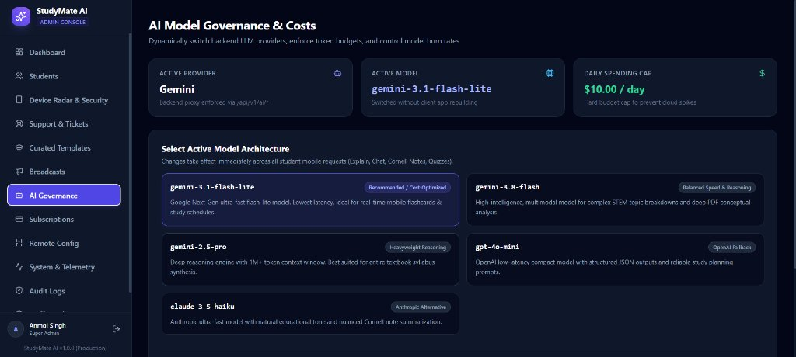

<div align="center">

  

  # 🎓 StudyMate AI
  ### The Premium AI-Powered Study Companion & Academic Productivity Suite for Android

  [](https://reactnative.dev/)
  [](https://expo.dev/)
  [](https://fastapi.tiangolo.com/)
  [](https://www.python.org/)
  [](https://www.postgresql.org/)
  [](https://ai.google.dev/)
  [](https://render.com/)
  [](https://vercel.com/)
  [](LICENSE)

  <br />

  <p align="center">
    <a href="https://study-mate-ai-android-apk.vercel.app/download">
      
    </a>
    &nbsp;&nbsp;
    <a href="https://study-mate-ai-android-apk.vercel.app">
      
    </a>
    &nbsp;&nbsp;
    <a href="https://studymate-backend-api.onrender.com/api/v1/health">
      
    </a>
  </p>

</div>

---

## 🌟 Overview

**StudyMate AI** is a state-of-the-art academic companion engineered specifically for university and college students. It combines cutting-edge Large Language Models (**Google Gemini**), structured **Cornell Note taking**, **Pomodoro Focus Timers with ambient soundscapes**, **Spaced Repetition Flashcards**, and **Dynamic Timetable/Attendance Tracking** into a polished, battery-efficient Android mobile client powered by a robust **FastAPI & PostgreSQL** backend.

The platform includes a real-time **React Vite Super Admin Web Console** providing full operational visibility, user telemetry, live AI model switching, dynamic remote configurations, and 1-click subscription monetization toggles.

---

## 📱 App Highlights & Visual Showcase

<div align="center">
  <table>
    <tr>
      <td width="33%" align="center">
        <b>📱 Student Smart Dashboard</b><br/><br/>
        <br/>
        <sub>Semester overview, daily study goal, subject progression, & quick focus widget</sub>
      </td>
      <td width="33%" align="center">
        <b>🤖 Gemini AI Study Buddy</b><br/><br/>
        <br/>
        <sub>Multimodal conceptual synthesis, Cornell notes, syllabus breakdown, & Q&A</sub>
      </td>
      <td width="33%" align="center">
        <b>⏱️ Pomodoro Focus Studio</b><br/><br/>
        <br/>
        <sub>25/5 interval timer, binaural ambient audio, streak tracking, & consistency heatmap</sub>
      </td>
    </tr>
  </table>

  <br />

  <table>
    <tr>
      <td align="center">
        <b>🖥️ Super Admin Web Console (AI Governance & Telemetry)</b><br/><br/>
        <br/>
        <sub>1-click AI model switching (Gemini 3.1, 3.8, Claude, GPT), live cost tracking, remote feature flags, & subscription management</sub>
      </td>
    </tr>
  </table>
</div>

---

## 🚀 Core Features

### 1. 🤖 Next-Gen AI Study Companion
- **Multi-Model LLM Gateway**: Powered natively by Google Gemini (`gemini-3.1-flash-lite`, `gemini-3.8-flash`, `gemini-2.5-pro`) with configurable fallback to OpenAI `gpt-4o-mini` and Anthropic `claude-3-5-haiku`.
- **Cornell Note Structuring**: Automatically condenses lengthy study materials into structured *Cues*, *Notes*, and *Summaries*.
- **Interactive Quizzes**: Generate exam-style multiple-choice and conceptual quizzes directly from notes.

### 2. ⏱️ Pomodoro Focus Timer & Binaural Soundscapes
- **Customizable Interval Blocks**: Standard 25/5 Pomodoro rhythm with customizable long breaks and sound notifications.
- **Ambient Audio Generator**: Integrated high-fidelity white noise, ambient rain, and cafe soundscapes to sustain deep focus.
- **Streak & Consistency Heatmap**: GitHub-style activity heatmaps visualizing weekly and monthly study streaks.

### 3. 🧠 Spaced Repetition Flashcards
- **Leitner Algorithm**: Automated review intervals based on recall confidence (Again, Hard, Good, Easy).
- **Deck Organization**: Categorized by university subjects, tags, and exam deadlines.

### 4. 📅 Timetable, Attendance & Smart Alarms
- **Weekly Schedule Matrix**: Dynamic class schedule with day-by-day room and faculty tagging.
- **Attendance Safeguard**: Real-time percentage tracking with automatic warnings when attendance nears minimum university thresholds (e.g. 75%).
- **Pre-Class Alarms**: Exact system alarms notifying students 10 minutes prior to lectures.

### 5. 🛡️ Enterprise-Grade Security & Privacy
- **Argon2id Password Hashing**: State-of-the-art memory-hard password encryption.
- **Hardware Keystore Storage**: JWT access and refresh tokens stored exclusively via `Expo SecureStore` (Android Keystore).
- **Application-Level User Ownership**: Every database query enforces strict tenant isolation (`WHERE user_id = :current_user_id`).
- **Secure Email Webhook Relay**: High-reliability password recovery OTP delivery with manual verification and zero API leaks.

### 6. 🎛️ Super Admin Operations Portal
- **AI Model Governance**: Dynamically switch active LLM models without mobile app rebuilding or code deployments.
- **Remote Config & Feature Flags**: Instantly toggle features (AI tutor, Pomodoro, Quizzes) or enforce minimum Android app versions.
- **Monetization & Subscriptions**: 100% Free Mode toggle for students with full backend readiness for Pro subscription tiers and INR pricing.
- **Live Telemetry & Device Radar**: Track real-time active sessions, device types, Android OS versions, and threat audits.
- **Support & Complaints Desk**: Filter, inspect, and resolve student bug reports and support tickets.

---

## 🏗️ Architecture & Technology Stack

```
                              ┌─────────────────────────────────────────┐
                              │       Android Mobile Application        │
                              │     React Native 0.88 + Expo SDK 58     │
                              │ TanStack Query v5 + Zustand + MMKV/Store│
                              └────────────────────┬────────────────────┘
                                                   │ HTTPS (Port 443)
                                                   ▼
┌────────────────────────────────────────────────────────────────────────┐
│                        FastAPI Modular Monolith                        │
│                 Python 3.12 + Pydantic v2 + SQLAlchemy 2.0             │
├────────────────────┬────────────────────┬──────────────────────────────┤
│    Auth Service    │  Study/Note Domain │      AI Tutor Gateway        │
│ Argon2id + JWT Rot │   CRUD + Leitner   │ Multi-Provider Proxy (Gemini)│
└─────────┬──────────┴─────────┬──────────┴──────────────┬───────────────┘
          │                    │                         │
          ▼                    ▼                         ▼
┌──────────────────┐ ┌───────────────────┐    ┌─────────────────────────┐
│ Cloud PostgreSQL │ │ Google Apps Script│    │ Google Gemini AI Engine │
│ 16+ (Render DB)  │ │ Email Relay (OTP) │    │  gemini-3.1-flash-lite  │
└──────────────────┘ └───────────────────┘    └─────────────────────────┘
          ▲
          │ SQL
┌─────────┴──────────────────────────────────────────────────────────────┐
│                   Vite React 19 Super Admin Console                    │
│             TailwindCSS + Lucide Icons (Hosted on Vercel)              │
└────────────────────────────────────────────────────────────────────────┘
```

| Layer | Technologies |
| :--- | :--- |
| **Mobile Client** | React Native `0.88.1`, Expo SDK `58`, Expo Router `v4`, TypeScript 5+, TanStack Query `v5`, Zustand, React Native Reanimated `4.7` |
| **Backend API** | FastAPI `0.115+`, Python `3.12+`, Pydantic `v2`, SQLAlchemy `2.0` (Async with `asyncpg`), Alembic migrations |
| **Database** | PostgreSQL `16+` with UUIDv4 primary keys, JSONB metadata, and index-optimized relational queries |
| **AI Integration** | Google Gemini (`google-genai`), configurable for OpenAI (`gpt-4o-mini`) and Anthropic (`claude-3-5-haiku`) |
| **Admin Web Console** | React `19`, Vite `6`, TailwindCSS `3.4`, Lucide Icons, Hosted on Vercel |
| **Cloud Hosting** | **Render** (FastAPI Web Service + PostgreSQL), **Vercel** (Admin Portal & Download Landing), **Expo EAS** (Android Cloud Builds) |

---

## 📂 Project Repository Structure

```
StudyMate-AI-Android/
├── apps/
│   ├── backend/                     # FastAPI Modular Monolith API
│   │   ├── alembic/                 # Database schema migrations (001 -> 017)
│   │   ├── app/
│   │   │   ├── api/v1/              # Versioned API routes & endpoints
│   │   │   ├── core/                # Config, security (Argon2id), rate limiters
│   │   │   ├── db/                  # Async session & base declarative models
│   │   │   ├── models/              # SQLAlchemy 2.0 database models
│   │   │   ├── repositories/        # Database access layer
│   │   │   ├── schemas/             # Pydantic v2 validation contracts
│   │   │   └── services/            # Core business logic & AI orchestration
│   │   ├── seed_admin.py            # Super admin and baseline config seeder
│   │   ├── run_prod.py              # Cloud production entrypoint
│   │   └── Dockerfile               # Production container definition
│   │
│   ├── mobile/                      # React Native Expo Android Client
│   │   ├── assets/                  # App icons, splash screens, audio assets
│   │   ├── src/
│   │   │   ├── app/                 # Expo Router file-based screens
│   │   │   ├── components/          # Reusable UI components & design system
│   │   │   ├── context/             # Authentication & global application state
│   │   │   ├── services/            # API client (TanStack Query)
│   │   │   └── types/               # TypeScript domain contracts
│   │   ├── app.json                 # Expo project manifest & Android permissions
│   │   └── eas.json                 # EAS build profiles (preview, production)
│   │
│   └── admin/                       # Vite React Super Admin Web Console
│       ├── public/                  # Static assets, download.html, privacy.html
│       ├── src/
│       │   ├── api/                 # Typed backend HTTP client
│       │   ├── components/          # Admin navigation, sidebar, metric badges
│       │   ├── pages/               # Dashboard, AI Governance, Subscriptions, etc.
│       │   └── types/               # Admin interface definitions
│       └── vercel.json              # SPA rewrites & clean routing
│
├── docs/                            # Architectural blueprints, roadmap, guides
│   ├── screenshots/                 # Application showcase images
│   ├── PRODUCT_ROADMAP.md           # Phased feature breakdown
│   ├── PLAY_STORE_LAUNCH_GUIDE.md   # Google Play Console deployment guide
│   └── SECURITY.md                  # Security, auth, & privacy architecture
│
├── render.yaml                      # Render Infrastructure-as-Code blueprint
└── README.md                        # Master project documentation
```

---

## ⚡ Quick Start & Local Development

### Prerequisites
- **Node.js**: `20.x` or `22.x LTS`
- **Python**: `3.12+`
- **PostgreSQL**: `16+` (or access to cloud PostgreSQL instance)
- **Expo CLI**: `npx expo`

---

### 1. Backend Setup (FastAPI)

```powershell
# Navigate to backend directory
cd apps/backend

# Create and activate virtual environment
python -m venv .venv
.venv\Scripts\activate      # Windows
# source .venv/bin/activate  # macOS / Linux

# Install dependencies
pip install -r requirements.txt

# Configure environment variables
cp .env.example .env
# Edit .env with your DATABASE_URL, GEMINI_API_KEY, SECRET_KEY

# Run database migrations
alembic upgrade head

# Seed initial Super Admin and baseline configs
python seed_admin.py

# Start local development server
uvicorn app.main:app --reload --port 8000
```
Backend API will be accessible at: `http://localhost:8000/docs` (Swagger UI).

---

### 2. Mobile App Setup (React Native Expo)

```powershell
# Navigate to mobile directory
cd apps/mobile

# Install verified Expo dependencies
npm install

# Run Expo development server
npx expo start

# Press 'a' to open in Android Emulator, or scan QR code via Expo Go
```

---

### 3. Admin Web Console Setup (React Vite)

```powershell
# Navigate to admin directory
cd apps/admin

# Install dependencies
npm install

# Start local Vite development server
npm run dev
```
Admin Console will be accessible at: `http://localhost:5173`.

---

## 🌐 Public Live Services

| Component | URL | Notes |
| :--- | :--- | :--- |
| **Android APK Direct Download** | [study-mate-ai-android-apk.vercel.app/download](https://study-mate-ai-android-apk.vercel.app/download) | Always points to latest verified build |
| **Admin Web Console** | [study-mate-ai-android-apk.vercel.app](https://study-mate-ai-android-apk.vercel.app) | Super Admin portal for operations |
| **FastAPI Backend API** | [studymate-backend-api.onrender.com](https://studymate-backend-api.onrender.com) | Production REST endpoints |
| **Cloud Health Diagnostic** | [studymate-backend-api.onrender.com/api/v1/health](https://studymate-backend-api.onrender.com/api/v1/health) | Live system status & database state |
| **Public Privacy Policy** | [study-mate-ai-android-apk.vercel.app/privacy.html](https://study-mate-ai-android-apk.vercel.app/privacy.html) | Google Play Store compliant policy |

---

## 📦 Building for Android & Play Store Release

### 1. Build Standalone Android APK (for Beta Testing)
```powershell
cd apps/mobile
npx eas-cli build -p android --profile preview
```

### 2. Build Android App Bundle (.AAB) (for Google Play Console)
```powershell
cd apps/mobile
npx eas-cli build -p android --profile production
```
Follow the step-by-step instructions in [`docs/PLAY_STORE_LAUNCH_GUIDE.md`](docs/PLAY_STORE_LAUNCH_GUIDE.md) to publish to Google Play Console.

---

## 🔒 Security & Disclosure

StudyMate AI adheres to rigorous security standards:
- **No Client Secrets**: API keys, database credentials, and signing secrets are strictly prohibited from client bundles.
- **Anti-Enumeration & Anti-Tamper**: Password reset endpoints do not leak credentials or codes via HTTP payloads.
- **Reporting Vulnerabilities**: If you discover a vulnerability, please reach out directly through the Admin Console Support Desk.

---

## 📄 License

This project is licensed under the **MIT License** — see the [LICENSE](LICENSE) file for details.

<div align="center">
  <sub>Built with ❤️ by Anmol Singh for university students worldwide.</sub><br/>
  <b>Study Smart... Grow Smart.</b>
</div>
