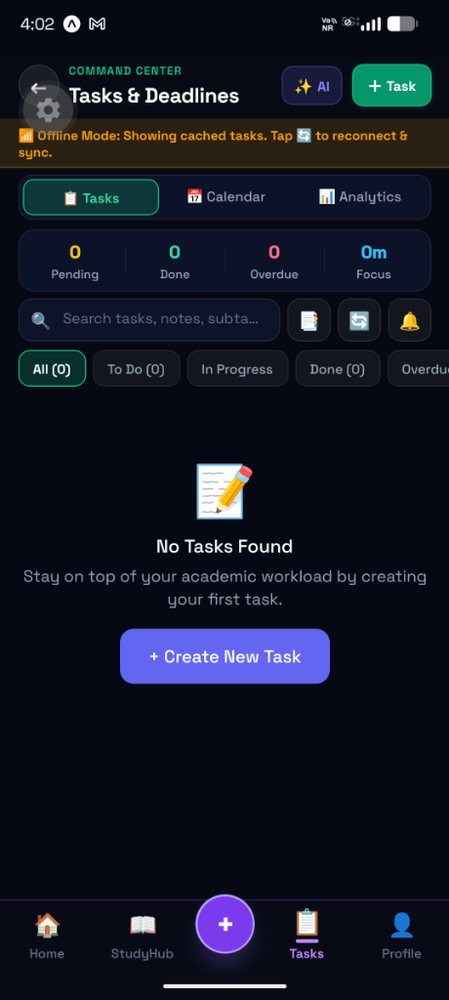
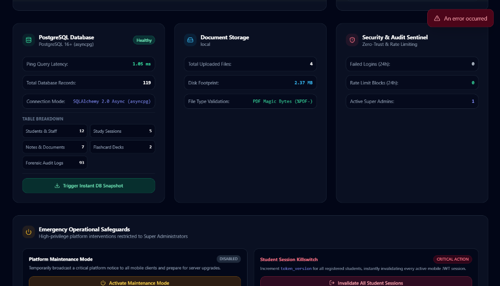
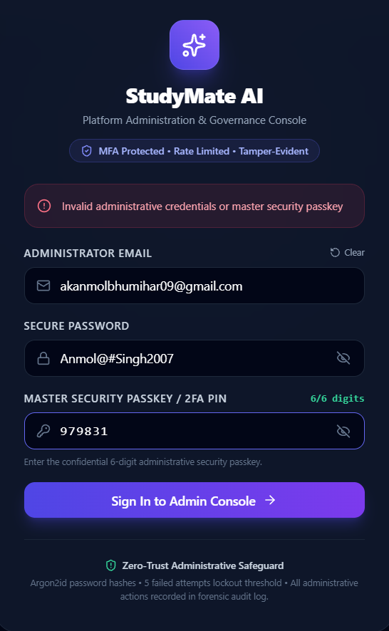

  

  # 🎓 StudyMate AI
  ### The Premium AI-Powered Student Learning & Productivity Application for Android

  
  
  
  
  
  
  

   

  

    
    &nbsp;&nbsp;
    
  

---

## 🌟 Overview

**StudyMate AI** is a premium, all-in-one student productivity and learning companion designed specifically for modern university and college students on Android.

Built completely from scratch with a focus on speed, beautiful dark aesthetics, and student privacy, StudyMate AI combines Google's advanced **Gemini AI** with proven study science techniques:
- **Interactive Cornell Note Taking**: Convert dense lecture notes into structured cues and summaries.
- **Pomodoro Focus Studio**: Integrated interval timer with ambient binaural soundscapes (rain, cafe, white noise).
- **Spaced Repetition Flashcards**: Leitner algorithm to help you remember topics long-term for exams.
- **Timetable & Attendance Safeguard**: Track your weekly class schedule with automatic 75% minimum attendance alerts and pre-lecture notification alarms.

---

## 📱 Mobile App Showcase

  <table>
    <tr>
      <td width="33%" align="center">
        <b>📱 Smart Student Dashboard</b>  
          
        Semester progress, daily study goal tracker, university subjects, and quick study widgets
      </td>
      <td width="33%" align="center">
        <b>🤖 Gemini AI Study Companion</b>  
          
        Ask complex questions, synthesize tough syllabus concepts, and generate Cornell notes instantly
      </td>
      <td width="33%" align="center">
        <b>⏱️ Pomodoro Focus Studio</b>  
          
        25/5 interval timer, binaural ambient focus audio, streaks, and GitHub-style study heatmaps
      </td>
    </tr>
  </table>

---

## 🚀 Key Student Features

### 1. 🤖 Gemini-Powered AI Study Buddy
- **Deep Concept Explanations**: Breakdown difficult STEM formulas, humanities essays, or computer science concepts in plain, easy-to-understand language.
- **Automated Cornell Notes**: Formats lecture content into Cues, Notes, and Exam Summaries.
- **Instant Quiz Generator**: Tests your understanding with multiple-choice questions and detailed explanations.

### 2. ⏱️ Focus Pomodoro & Ambient Soundscapes
- **Customizable Intervals**: 25-minute study sprints with 5-minute restorative breaks.
- **Background Soundscapes**: Built-in binaural audio tracks (ambient rain, study cafe, deep focus frequency) to cancel surrounding noise during study sessions.
- **Study Consistency Heatmap**: Visualizes your daily focus time and keeps your study streak alive.

### 3. 🧠 Spaced Repetition Flashcards
- **Leitner Active Recall**: Prioritizes difficult cards and spaces out familiar topics to optimize long-term memory retention before finals.
- **Subject Categorization**: Keep cards organized by semester subjects, exams, or chapters.

### 4. 📅 Timetable, Attendance Tracker & Alarms
- **Smart Attendance Thresholds**: Tracks attendance percentage per subject and sends alerts if you drop below minimum required percentages.
- **Exact Lecture Alarms**: Automated reminders sent to your Android phone before classes start.

---

## 🔒 Security & Student Privacy

Student privacy and data safety are built into the core design:
- **Zero Client API Keys**: No AI keys or sensitive secrets are embedded in the mobile application. All requests pass through secure backend gateways.
- **Hardware Keystore Token Storage**: Authentication tokens are stored exclusively using Android's hardware-backed **Keystore (Expo SecureStore)**.
- **Argon2id Password Security**: Passwords are encrypted with industry-standard Argon2id hashing.
- **Isolated Data Access**: Strict application-level tenant isolation ensures students can only view their own notes, schedules, and flashcards.
- **No Data Selling**: Your study notes and personal academic information are never sold or shared with third parties.

---

## 📲 How to Install & Run

### Direct APK Download (Android 8.0+)
1. Download the latest verified APK directly from the public download page:  
   👉 **[Download StudyMate AI for Android](https://study-mate-ai-android-apk.vercel.app/download)**
2. Open the downloaded `.apk` file on your Android device.
3. If prompted by your browser, tap **Settings** and enable **"Allow from this source"**.
4. Tap **Install** and launch StudyMate AI!

---

## 🛠️ Technology Stack

| Layer | Technologies |
| :--- | :--- |
| **Mobile Client** | React Native `0.88`, Expo SDK `58`, Expo Router `v4`, TypeScript 5+, TanStack Query `v5`, Zustand, React Native Reanimated `4.7` |
| **Backend API** | FastAPI, Python 3.12+, Pydantic v2, SQLAlchemy 2.0 Async (`asyncpg`), Alembic |
| **Cloud Database** | PostgreSQL 16+ |
| **AI Architecture** | Google Gemini Engine (`gemini-3.1-flash-lite`, `gemini-3.8-flash`) |
| **Build & Deploy** | Expo Application Services (EAS Build), Render Cloud Engine |

---

## 📄 Privacy Policy & Terms

Read our comprehensive, Google Play Store compliant Privacy Policy:  
👉 **[StudyMate AI Privacy Policy](https://study-mate-ai-android-apk.vercel.app/privacy.html)**

---

## 👨‍💻 Developer & Credits

Crafted with ❤️ by **Anmol Singh** for university students worldwide.  
*Study Smart... Grow Smart.*

---

## 📜 License

This project is licensed under the **MIT License** — see the [LICENSE](LICENSE) file for details.
