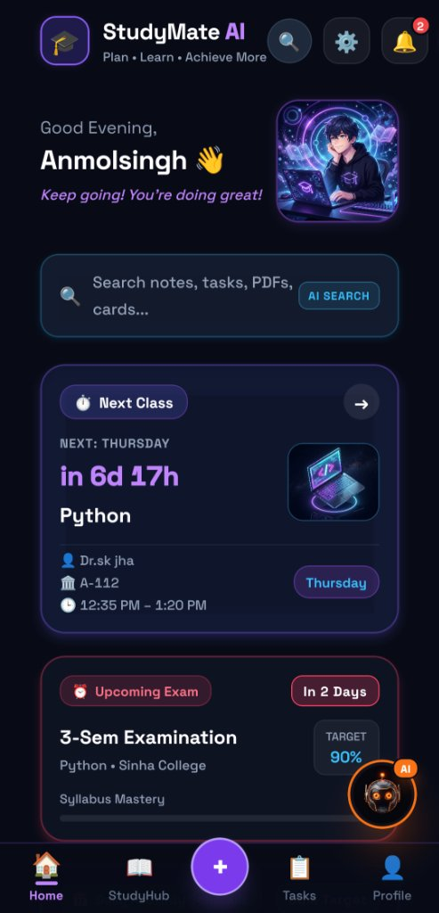
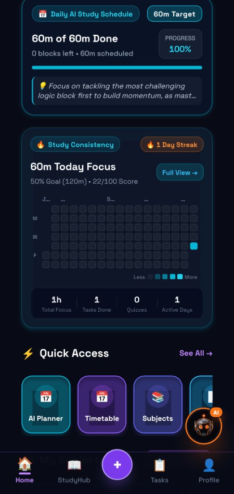
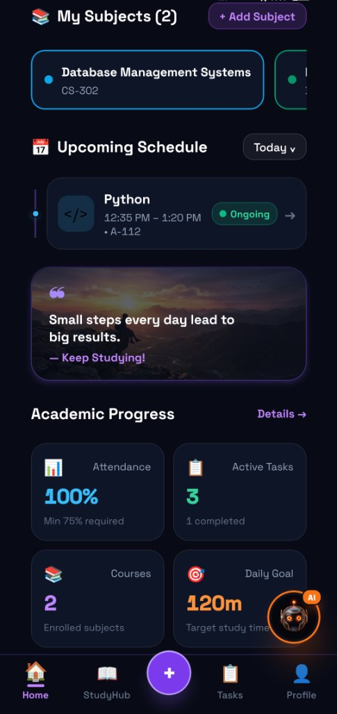
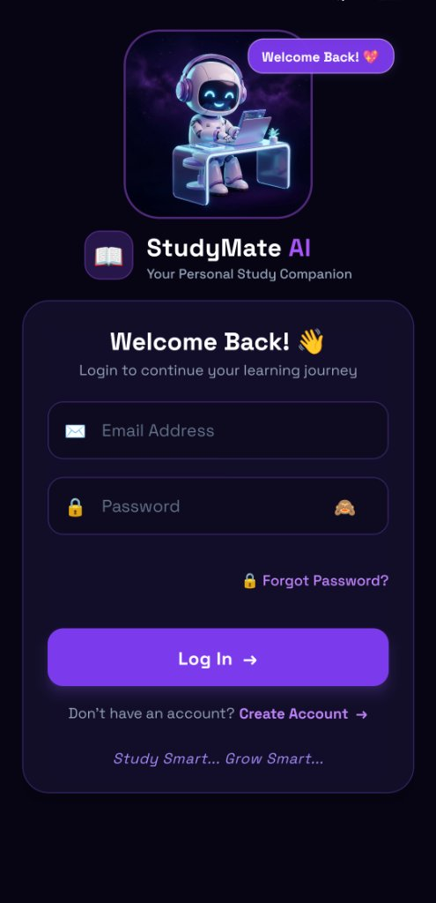
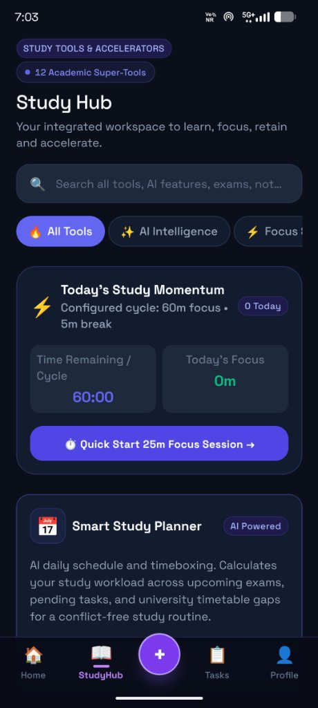
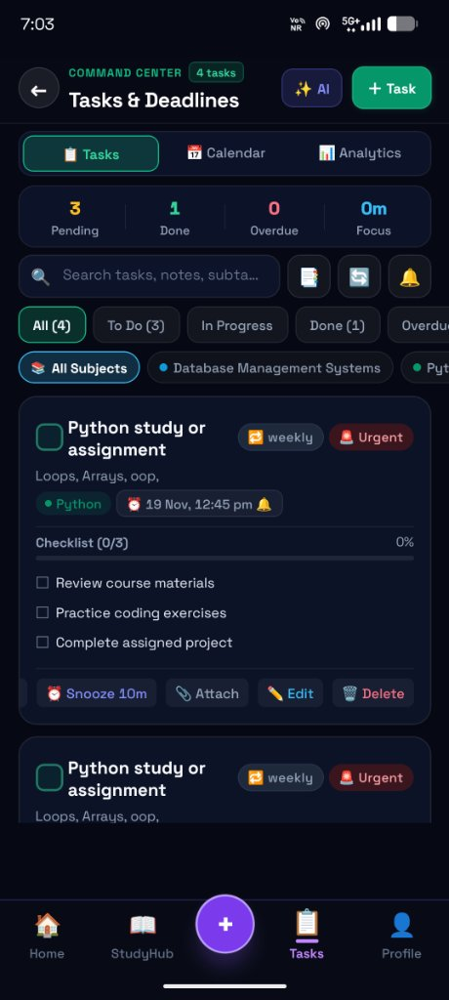

  

  # 🎓 StudyMate AI
  ### The Premium AI-Powered Student Learning & Academic Productivity Suite for Android

  
  
  
  
  
  
  
  

   

  

    
    &nbsp;&nbsp;
    
  

---

## 🌟 Overview

**StudyMate AI** is a premium, all-in-one student productivity and learning companion designed specifically for modern university and college students on Android.

Built completely from scratch with a focus on speed, beautiful dark aesthetics, and student privacy, StudyMate AI combines Google's advanced **Gemini AI** with proven study science techniques:
- **Interactive Cornell Note Taking**: Convert dense lecture notes into structured cues, formulas, and summaries.
- **Smart Study Hub**: Integrated workspace for daily momentum, 25-minute focus sprints, and AI timeboxing.
- **Tasks & Deadlines Command Center**: Smart task manager with checklists, priority badges, and reminder alarms.
- **Timetable & Attendance Safeguard**: Track your weekly class schedule with automatic 75% minimum attendance alerts and lecture alarms.
- **Study Consistency Heatmap**: GitHub-style activity grid to visualize daily focus streaks and study habits.

---

## 📱 Mobile App Showcase

### 🏠 Complete Home & Academic Dashboard Experience
*The student home experience is organized into three intuitive scroll regions:*

  <table>
    <tr>
      <td width="33%" align="center">
        <b>1️⃣ Overview & Next Class</b>  
          
        Live greeting, universal AI search, countdown to next lecture, and upcoming exam alert with target score
      </td>
      <td width="33%" align="center">
        <b>2️⃣ Schedule & Study Heatmap</b>  
          
        Daily AI study schedule (100% progress), study consistency grid heatmap, focus streaks, and quick tool shortcuts
      </td>
      <td width="33%" align="center">
        <b>3️⃣ Subjects & Attendance Progress</b>  
          
        Enrolled subjects (DBMS, Python), ongoing class badge, daily motivational quote, and 100% attendance safeguard
      </td>
    </tr>
  </table>

 

### 🔐 Authentication, 📚 Study Hub & 📋 Tasks Command Center

  <table>
    <tr>
      <td width="33%" align="center">
        <b>🔐 Secure Student Login</b>  
          
        Clean 3D mascot interface, secure Argon2id password authentication, and fast 1-click recovery
      </td>
      <td width="33%" align="center">
        <b>📚 Integrated Study Hub</b>  
          
        12 Academic Super-Tools, real-time momentum cycle tracker, quick-start 25m focus sprint, and AI Planner
      </td>
      <td width="33%" align="center">
        <b>📋 Tasks & Deadlines Command Center</b>  
          
        Interactive subtask checklists, urgent priority tags, subject filters, snooze alarms, and calendar views
      </td>
    </tr>
  </table>

---

## 🚀 Key Student Features

### 1. 🤖 Gemini-Powered AI Study Companion
- **Deep Concept Explanations**: Breakdown difficult STEM formulas, humanities essays, or computer science concepts in plain, easy-to-understand language.
- **Automated Cornell Notes**: Formats lecture content into Cues, Notes, and Exam Summaries.
- **Instant Quiz Generator**: Tests your understanding with multiple-choice questions and detailed explanations.

### 2. 📚 Integrated Study Hub (12 Academic Super-Tools)
- **Study Momentum Tracker**: Configurable study cycles (e.g. 60 min focus + 5 min break) with instant progress metrics.
- **Quick-Start 25m Focus Session**: Launch deep work sessions in 1-tap with ambient background noise reduction.
- **Smart Study Planner**: AI-calculated study timeboxing that distributes workload across upcoming exams, pending tasks, and university timetable gaps.

### 3. 📋 Tasks & Deadlines Command Center
- **Structured Task Breakdown**: Attach multi-step checklists to complex assignments (e.g. review course materials, practice coding exercises, complete assigned project).
- **Urgent Priority Matrix**: Visual indicators for urgent, weekly, and high-impact deadlines.
- **Snooze & Calendar Sync**: Snooze reminders by 10 minutes or sync deadlines into the academic calendar.

### 4. 📅 Timetable, Attendance Tracker & Alarms
- **Smart Attendance Thresholds**: Tracks attendance percentage per subject (e.g. 100% current) and sends warnings if you near minimum university thresholds (e.g. 75%).
- **Exact Lecture Alarms**: Automated reminders sent to your Android phone before classes start (e.g. Python in Room A-112).

---

## 🔒 Security & Student Privacy

Student privacy and data safety are built into the core design:
- **Zero Client API Keys**: No AI keys or sensitive secrets are embedded in the mobile application. All requests pass through secure backend gateways.
- **Hardware Keystore Token Storage**: Authentication tokens are stored exclusively using Android's hardware-backed **Keystore (Expo SecureStore)**.
- **Argon2id Password Security**: Passwords are encrypted with industry-standard Argon2id hashing. Plaintext passwords are never logged or stored.
- **Strict Isolated Data Access**: Multi-tenant database isolation ensures students can only view their own notes, schedules, and flashcards (`WHERE user_id = :current_user_id`).
- **No Data Selling**: Your study notes and personal academic information are never sold or shared with third parties.

---

## 📲 How to Install & Run

### Direct APK Download (Android 8.0+)
1. Download the latest verified APK directly from the public download page:  
   👉 **[Download StudyMate AI for Android](https://study-mate-ai-android-apk.vercel.app/download)**
2. Open the downloaded `.apk` file on your Android device.
3. If prompted by your browser, tap **Settings** and enable **"Allow from this source"**.
4. Tap **Install** and launch StudyMate AI!

---

## 🛠️ Technology Stack

| Layer | Technologies |
| :--- | :--- |
| **Mobile Client** | React Native `0.88`, Expo SDK `58`, Expo Router `v4`, TypeScript 5+, TanStack Query `v5`, Zustand, React Native Reanimated `4.7` |
| **Backend API** | FastAPI, Python 3.12+, Pydantic v2, SQLAlchemy 2.0 Async (`asyncpg`), Alembic |
| **Cloud Database** | PostgreSQL 16+ on Cloud Infrastructure |
| **AI Architecture** | Google Gemini Engine (`gemini-3.1-flash-lite`, `gemini-3.8-flash`) |
| **Build & Release** | Expo Application Services (EAS Build), Render Cloud Engine |

---

## 📄 Privacy Policy & Terms

Read our comprehensive, Google Play Store compliant Privacy Policy:  
👉 **[StudyMate AI Privacy Policy](https://study-mate-ai-android-apk.vercel.app/privacy.html)**

---

## 👨‍💻 Developer & Credits

Crafted with ❤️ by **Anmol Singh** for university students worldwide.  
*Study Smart... Grow Smart.*

---

## 📜 License

This project is licensed under the **MIT License** — see the [LICENSE](LICENSE) file for details.
