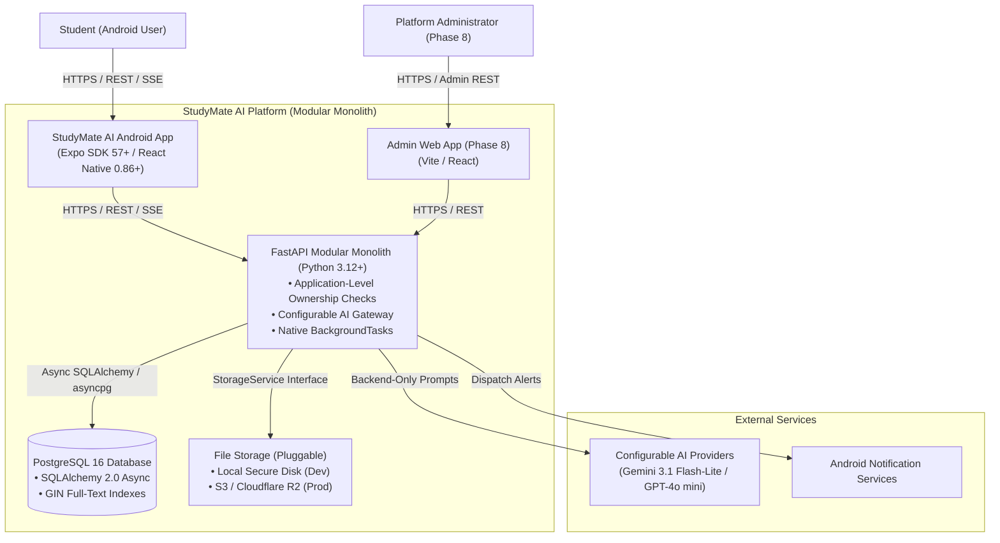
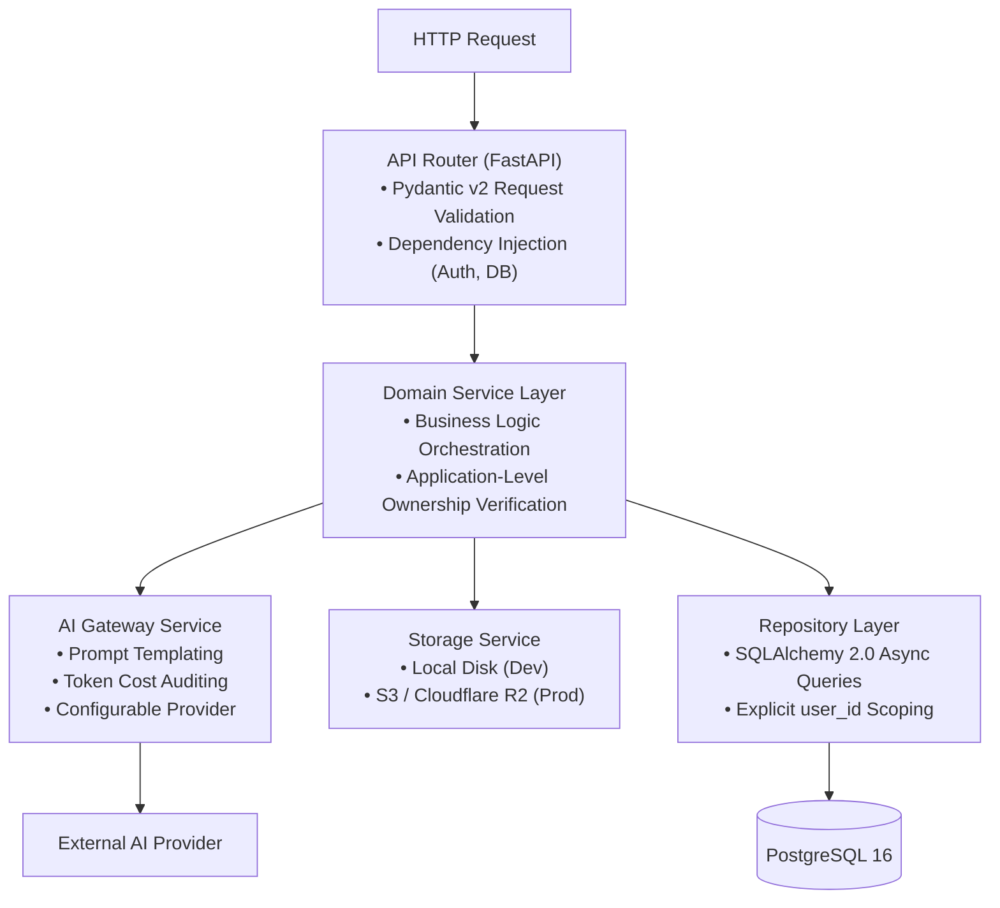

# StudyMate AI — Technical Architecture Specification

## 1. System Overview & Architectural Topology

StudyMate AI is architected as a **modular monolith** optimized for clean development velocity, robust security, and lightweight operational overhead:
1. **Mobile Client (Android)**: React Native with Expo and Expo Router, operating as an untrusted public client.
2. **API Backend**: Asynchronous Python FastAPI application enforcing authentication, business logic, authorization, and data validation.
3. **Relational Database**: PostgreSQL 16+ serving as the single source of truth with application-level user ownership enforcement.
4. **Asynchronous Processing (Initial)**: Native FastAPI `BackgroundTasks` behind an abstract service interface (`TaskQueueInterface`) for non-blocking PDF parsing and AI calls. Heavy distributed task queues (Celery/Redis) are intentionally deferred until scale mandates them.
5. **Pluggable File Storage**: Abstracted `StorageService` interface utilizing secure local disk storage (`uploads/documents/{user_id}/`) during initial development, with seamless configuration for S3-compatible cloud storage (Cloudflare R2 / AWS S3) for production.
6. **Configurable AI Gateway**: Abstracted backend adapter interfacing with external AI providers (Google Gemini, OpenAI) via backend environment variables.
7. **Web Admin Panel (Phase 8)**: Separate web application consuming dedicated administrative APIs post-core stability.

---

## 2. High-Level Architecture Diagrams

### 2.1 C4 System Context Diagram



---

### 2.2 Container Diagram & Communication Protocols

```mermaid
flowchart LR
    subgraph ClientLayer["Client Layer (Untrusted)"]
        Mobile["Android App\n(React Native / Expo Router)\n• TanStack Query v5\n• Zustand\n• MMKV Storage (Cache)\n• Expo SecureStore (JWTs)"]
    end

    subgraph AppLayer["Application Layer (Modular Monolith)"]
        API["FastAPI Backend\n• Pydantic v2 Validation\n• JWT Auth & Role Checks\n• Repository Layer (user_id scoped)\n• BackgroundTasks Execution"]
    end

    subgraph DataLayer["Persistence & Storage Layer"]
        DB[("PostgreSQL 16\n• User, Note, Task, Quiz DDL\n• GIN tsvector Indexes")]
        Storage["Storage Service\n• Local Disk (uploads/)\n• Cloudflare R2 / S3 (Prod)"]
    end

    subgraph ExternalLayer["External Services"]
        LLM["AI Provider API\n(Gemini 3.1 Flash-Lite / GPT-4o mini)"]
    end

    Mobile -->|HTTPS / REST JSON| API
    Mobile -->|Server-Sent Events (SSE)| API
    API -->|Async Connection Pool| DB
    API -->|Read / Write Streams| Storage
    API -->|Streaming Prompts| LLM
```

---

## 3. Mobile Client Architecture (React Native & Expo)

### 3.1 Framework Versions & Dependency Alignment
* **Expo SDK**: Verified current stable **Expo SDK 57+**.
* **React Native**: **0.86+** with the **New Architecture** enabled by default for native C++ performance and synchronous layout calculation.
* **React**: **19.2+**.
* **Navigation**: **Expo Router** (bundled with the SDK for modern file-based routing).
* **Node.js**: **Node.js 20+ LTS** (or 22 LTS).
* **Dependency Installation Guarantee**:
  * Project initialization via `npx create-expo-app@latest`.
  * Package installations strictly use:
    ```bash
    npx expo install <package-name>
    ```
    This ensures all packages match the verified Expo SDK release matrix.
  * Continuous health checks via `npx expo-doctor`.

### 3.2 State Management Strategy
The mobile client decouples **Server State** from **Client UI State**:

| State Category | Technology | Usage & Scope |
| :--- | :--- | :--- |
| **Server State** | TanStack Query v5 (`@tanstack/react-query`) | Handles all data fetching, caching, deduplication, optimistic updates, and background refetching. Configured with garbage collection and persistent offline cache adapter. |
| **Global Client State** | Zustand | Lightweight stores for transient UI states: active Pomodoro countdown, audio playback controls, active filter selections. |
| **Persistent Key-Value** | React Native MMKV | Ultra-fast C++ based key-value store for app settings, theme preference (Dark/Light), onboarding status, and cached query states. |
| **Sensitive Secrets** | Expo SecureStore | Hardware-backed encrypted storage (Android Keystore) exclusively for JWT access and refresh tokens. |

### 3.3 Mobile Directory Architecture
```
apps/mobile/
├── app/                          # Expo Router File-Based Routes
│   ├── (auth)/                   # Authentication Group
│   │   ├── login.tsx
│   │   ├── register.tsx
│   │   └── forgot-password.tsx
│   ├── (tabs)/                   # Core Application Tabs
│   │   ├── _layout.tsx
│   │   ├── index.tsx             # Dashboard Home (FR-02)
│   │   ├── timetable.tsx         # Schedule & Calendar (FR-11)
│   │   ├── pomodoro.tsx          # Focus Timer (FR-12)
│   │   ├── library.tsx           # Notes & Documents (FR-06, FR-08)
│   │   └── settings.tsx          # App Settings & Profile (FR-20)
│   ├── ai/                       # AI Dedicated Features
│   │   ├── chat.tsx              # AI Chat Assistant (FR-03)
│   │   ├── explain.tsx           # AI Topic Explanations (FR-04)
│   │   └── generate-notes.tsx    # AI Notes Generation (FR-05)
│   ├── study/                    # Learning & Mastery Tools
│   │   ├── quiz/[id].tsx         # Active Quiz Session (FR-14)
│   │   ├── flashcards/[deckId].tsx # Spaced Repetition Review (FR-15)
│   │   └── exam/[id].tsx         # Exam Preparation Hub (FR-13)
│   ├── tasks/                    # Task Management Screens
│   │   ├── index.tsx
│   │   └── [id].tsx
│   ├── _layout.tsx               # Root Layout, Theme & Auth Providers
│   └── +not-found.tsx
├── src/
│   ├── api/                      # Axios/Fetch Clients & TanStack Query Hooks
│   ├── components/               # Atomic Design UI Components (Button, Card, Modal)
│   ├── hooks/                    # Reusable React Hooks (usePomodoro, useTheme)
│   ├── stores/                   # Zustand Stores (usePomodoroStore)
│   ├── types/                    # Shared TypeScript interfaces & DTOs
│   └── constants/                # Design tokens, color palettes, spacing
├── app.json                      # Expo Configuration
└── package.json
```

---

## 4. Backend Service Architecture (Modular Monolith)

### 4.1 Layered Service Pattern
The backend adheres to a strict, unidirectional layered architecture:
$$\text{HTTP Request} \longrightarrow \text{Routing / Controller} \longrightarrow \text{Domain Service} \longrightarrow \text{Repository / Data Access} \longrightarrow \text{PostgreSQL Database}$$



1. **API Routers (`app/api/v1/`)**: Pure presentation layer. Responsible only for route mapping, HTTP status codes, dependency injection, and Pydantic validation.
2. **Domain Services (`app/services/`)**: Encapsulates core business rules, coordinates repositories, and interfaces with external AI and storage services.
3. **Data Access Repositories (`app/repositories/`)**: Encapsulates all SQLAlchemy queries. **Zero SQL queries are written in routers.**
4. **Data Models (`app/models/`)**: SQLAlchemy 2.0 declarative database models with explicit type annotations.

---

## 5. AI Service Architecture & Model Configuration

### 5.1 Configurable AI Gateway
To prevent vendor lock-in and support runtime provider changes without code modifications, StudyMate AI implements an abstract `AIGateway` protocol:

```python
class BaseAIProvider(ABC):
    @abstractmethod
    async def generate_completion(self, prompt: str, schema: Type[BaseModel] | None = None) -> str: ...
    
    @abstractmethod
    async def stream_chat(self, history: list[ChatMessage], prompt: str) -> AsyncIterator[str]: ...

class AIGateway:
    def __init__(self, provider: BaseAIProvider):
        self.provider = provider

    async def generate(self, prompt: str, schema: Type[BaseModel] | None = None) -> str:
        return await self.provider.generate_completion(prompt, schema)

    async def stream(self, history: list[ChatMessage], prompt: str) -> AsyncIterator[str]:
        async for chunk in self.provider.stream_chat(history, prompt):
            yield chunk
```

* Supported Verified Models:
  * **Google Gemini**: `gemini-3.1-flash-lite` (low-cost workhorse), `gemini-3.8-flash` (flagship reasoning) via `google-genai`.
  * **OpenAI**: `gpt-4o-mini` (structured output economy), `gpt-4o` (advanced reasoning).
* Configuration: Controlled strictly via backend `.env` variables:
  ```ini
  PRIMARY_AI_PROVIDER=gemini # gemini | openai
  AI_MODEL_NAME=gemini-3.1-flash-lite
  AI_API_KEY=your_secure_backend_api_key
  ```

---

## 6. Document Ingestion & Pluggable Storage

### 6.1 Minimum Viable Upload Architecture
1. **Upload**: Mobile client sends multipart/form-data to `POST /api/v1/documents/upload`.
2. **Validation**:
   * Content-Type header checked for `application/pdf`.
   * File size strictly checked ($\le 25\text{MB}$).
   * Magic bytes inspected (`%PDF-`) from initial stream bytes.
3. **Storage Abstraction (`StorageService`)**:
   * **Development**: Saved to `uploads/documents/{user_id}/{doc_uuid}.pdf` outside the static web root.
   * **Production**: Streams to S3/Cloudflare R2 bucket.
4. **Background Summarization**:
   * FastAPI's `BackgroundTasks` executes text extraction (`pypdf`) and sends chunked text to the AI Gateway to generate TL;DR and Key Concepts.
   * Document status transitions from `PROCESSING` to `READY`.
5. **Access Control**:
   * Files can only be downloaded via `GET /api/v1/documents/{id}/file`, which verifies `user_id == current_user.id` before streaming bytes to the client.

---

## 7. Security: Application-Level Ownership vs. Database RLS

StudyMate AI explicitly distinguishes between two architectural mechanisms for tenant isolation:

1. **Application-Level User Ownership Checks (Primary & Enforced)**:
   * Enforced in the FastAPI repository layer.
   * Every SQL query accessing student assets includes an explicit predicate:
     ```python
     async def get_note_by_id(db: AsyncSession, user_id: UUID, note_id: UUID) -> Note | None:
         query = select(Note).where(Note.id == note_id, Note.user_id == user_id)
         result = await db.execute(query)
         return result.scalar_one_or_none()
     ```
   * Enforced in automated IDOR test suites that assert cross-tenant access returns `404 Not Found`.

2. **PostgreSQL Row-Level Security (RLS) (Optional Secondary Defense-in-Depth)**:
   * Enforced inside the PostgreSQL engine via session variables (`app.current_user_id`).
   * Decoupled from application logic to avoid async connection-pool state leakage with `asyncpg`. Application-level ownership checks remain our primary, deterministic security guarantee.
