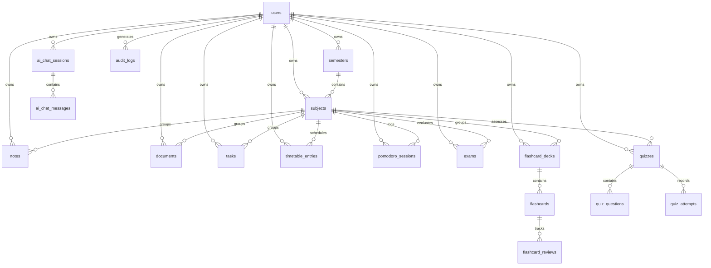

# StudyMate AI — PostgreSQL Database Schema Specification

## 1. Schema Design Principles & Ownership Architecture

The StudyMate AI relational schema is architected according to strict industrial standards:
1. **Application-Level User Ownership Enforcement**: Every entity owned by a student contains an explicit `user_id UUID NOT NULL REFERENCES users(id) ON DELETE CASCADE`. Every application query must filter by `user_id`.
2. **Distinction from Database RLS**: The primary tenant isolation mechanism is application-level scoping enforced in repositories and verified by integration tests. Database-level PostgreSQL Row-Level Security (RLS) policies are an optional secondary defense-in-depth layer, but are not relied upon for basic access control to avoid async connection-pool state leakage.
3. **UUID Primary Keys**: All tables utilize UUIDv4 (`UUID`) primary keys to prevent resource enumeration attacks.
4. **Audit Columns**: Standard `created_at TIMESTAMPTZ NOT NULL DEFAULT NOW()` and `updated_at TIMESTAMPTZ NOT NULL DEFAULT NOW()` columns on all persistent records.
5. **Full-Text Search Optimization**: PostgreSQL `tsvector` columns with `GIN` indexing for high-performance search over student notes, documents, and flashcards.
6. **Timezone Awareness**: All timestamps strictly use `TIMESTAMPTZ` (UTC).

---

## 2. Entity-Relationship (ER) Diagram



---

## 3. Comprehensive DDL Specifications

### 3.1 Authentication & Core User Domain

#### `users`
Represents registered students and administrative accounts.
```sql
CREATE TYPE user_role AS ENUM ('student', 'content_manager', 'support_admin', 'super_admin');
CREATE TYPE user_status AS ENUM ('active', 'suspended', 'pending_verification');

CREATE TABLE users (
    id UUID PRIMARY KEY DEFAULT gen_random_uuid(),
    email VARCHAR(255) NOT NULL UNIQUE,
    hashed_password VARCHAR(255) NOT NULL,
    full_name VARCHAR(150) NOT NULL,
    avatar_url VARCHAR(500),
    role user_role NOT NULL DEFAULT 'student',
    status user_status NOT NULL DEFAULT 'active',
    
    -- Academic Profile
    institution VARCHAR(200),
    major VARCHAR(200),
    graduation_year INT,
    daily_study_goal_minutes INT NOT NULL DEFAULT 120,
    
    -- Settings & Preferences
    theme_preference VARCHAR(20) NOT NULL DEFAULT 'system',
    push_notifications_enabled BOOLEAN NOT NULL DEFAULT true,
    quiet_hours_start TIME,
    quiet_hours_end TIME,
    
    -- Security
    last_login_at TIMESTAMPTZ,
    token_version INT NOT NULL DEFAULT 1,
    created_at TIMESTAMPTZ NOT NULL DEFAULT NOW(),
    updated_at TIMESTAMPTZ NOT NULL DEFAULT NOW()
);

CREATE INDEX idx_users_email ON users(email);
CREATE INDEX idx_users_status_role ON users(status, role);
```

#### `user_sessions`
Active client refresh tokens and device metadata.
```sql
CREATE TABLE user_sessions (
    id UUID PRIMARY KEY DEFAULT gen_random_uuid(),
    user_id UUID NOT NULL REFERENCES users(id) ON DELETE CASCADE,
    refresh_token_hash VARCHAR(255) NOT NULL UNIQUE,
    device_name VARCHAR(150),
    device_os VARCHAR(50),
    ip_address INET,
    is_revoked BOOLEAN NOT NULL DEFAULT false,
    expires_at TIMESTAMPTZ NOT NULL,
    created_at TIMESTAMPTZ NOT NULL DEFAULT NOW()
);

CREATE INDEX idx_user_sessions_lookup ON user_sessions(user_id, is_revoked);
```

---

### 3.2 Academic Structure Domain

#### `semesters`
```sql
CREATE TABLE semesters (
    id UUID PRIMARY KEY DEFAULT gen_random_uuid(),
    user_id UUID NOT NULL REFERENCES users(id) ON DELETE CASCADE,
    title VARCHAR(100) NOT NULL,            -- e.g., "Fall 2026"
    start_date DATE NOT NULL,
    end_date DATE NOT NULL,
    is_current BOOLEAN NOT NULL DEFAULT false,
    is_archived BOOLEAN NOT NULL DEFAULT false,
    created_at TIMESTAMPTZ NOT NULL DEFAULT NOW(),
    updated_at TIMESTAMPTZ NOT NULL DEFAULT NOW()
);

CREATE INDEX idx_semesters_user_current ON semesters(user_id, is_current);
CREATE UNIQUE INDEX uq_user_active_semester ON semesters(user_id) WHERE is_current = true;
```

#### `subjects`
```sql
CREATE TABLE subjects (
    id UUID PRIMARY KEY DEFAULT gen_random_uuid(),
    user_id UUID NOT NULL REFERENCES users(id) ON DELETE CASCADE,
    semester_id UUID REFERENCES semesters(id) ON DELETE SET NULL,
    code VARCHAR(50),                       -- e.g., "CS-301"
    name VARCHAR(150) NOT NULL,             -- e.g., "Data Structures & Algorithms"
    instructor_name VARCHAR(150),
    instructor_email VARCHAR(255),
    color_hex VARCHAR(7) NOT NULL DEFAULT '#6366F1',
    icon_name VARCHAR(50) NOT NULL DEFAULT 'book',
    credit_hours NUMERIC(3, 1) DEFAULT 3.0,
    target_grade VARCHAR(5),
    is_archived BOOLEAN NOT NULL DEFAULT false,
    created_at TIMESTAMPTZ NOT NULL DEFAULT NOW(),
    updated_at TIMESTAMPTZ NOT NULL DEFAULT NOW()
);

CREATE INDEX idx_subjects_user ON subjects(user_id);
CREATE INDEX idx_subjects_semester ON subjects(semester_id);
```

---

### 3.3 Notes & Documents Library Domain

#### `notes`
```sql
CREATE TYPE note_type AS ENUM ('standard', 'cornell', 'ai_generated', 'summary');

CREATE TABLE notes (
    id UUID PRIMARY KEY DEFAULT gen_random_uuid(),
    user_id UUID NOT NULL REFERENCES users(id) ON DELETE CASCADE,
    subject_id UUID REFERENCES subjects(id) ON DELETE CASCADE,
    title VARCHAR(250) NOT NULL,
    content_raw TEXT NOT NULL DEFAULT '',
    content_json JSONB,                     -- Rich text editor representation
    note_type note_type NOT NULL DEFAULT 'standard',
    is_favorite BOOLEAN NOT NULL DEFAULT false,
    is_pinned BOOLEAN NOT NULL DEFAULT false,
    
    search_vector TSVECTOR,
    created_at TIMESTAMPTZ NOT NULL DEFAULT NOW(),
    updated_at TIMESTAMPTZ NOT NULL DEFAULT NOW()
);

CREATE INDEX idx_notes_user_subject ON notes(user_id, subject_id);
CREATE INDEX idx_notes_search ON notes USING GIN(search_vector);

CREATE OR REPLACE FUNCTION notes_vector_update() RETURNS trigger AS $$
BEGIN
    NEW.search_vector := to_tsvector('english', coalesce(NEW.title, '') || ' ' || coalesce(NEW.content_raw, ''));
    RETURN NEW;
END
$$ LANGUAGE plpgsql;

CREATE TRIGGER trg_notes_search_update BEFORE INSERT OR UPDATE ON notes
FOR EACH ROW EXECUTE FUNCTION notes_vector_update();
```

#### `documents`
Uploaded course PDFs, slide decks, and summaries.
```sql
CREATE TYPE doc_status AS ENUM ('upload_pending', 'processing', 'ready', 'failed');

CREATE TABLE documents (
    id UUID PRIMARY KEY DEFAULT gen_random_uuid(),
    user_id UUID NOT NULL REFERENCES users(id) ON DELETE CASCADE,
    subject_id UUID REFERENCES subjects(id) ON DELETE SET NULL,
    title VARCHAR(250) NOT NULL,
    file_name VARCHAR(255) NOT NULL,
    file_size_bytes BIGINT NOT NULL,
    mime_type VARCHAR(100) NOT NULL DEFAULT 'application/pdf',
    storage_key VARCHAR(500) NOT NULL UNIQUE, -- URI: e.g., 'local://documents/{user_id}/{doc_id}.pdf' or 's3://...'
    file_hash_sha256 VARCHAR(64) NOT NULL,
    page_count INT,
    status doc_status NOT NULL DEFAULT 'upload_pending',
    error_message TEXT,
    
    summary_tldr TEXT,
    summary_key_concepts JSONB,
    extracted_text_snippet TEXT,
    
    search_vector TSVECTOR,
    created_at TIMESTAMPTZ NOT NULL DEFAULT NOW(),
    updated_at TIMESTAMPTZ NOT NULL DEFAULT NOW()
);

CREATE INDEX idx_documents_user ON documents(user_id);
CREATE INDEX idx_documents_status ON documents(status);
CREATE INDEX idx_documents_search ON documents USING GIN(search_vector);
```

---

### 3.4 Productivity & Focus Domain

#### `tasks`
```sql
CREATE TYPE task_priority AS ENUM ('low', 'medium', 'high', 'urgent');
CREATE TYPE task_status AS ENUM ('todo', 'in_progress', 'completed', 'cancelled');

CREATE TABLE tasks (
    id UUID PRIMARY KEY DEFAULT gen_random_uuid(),
    user_id UUID NOT NULL REFERENCES users(id) ON DELETE CASCADE,
    subject_id UUID REFERENCES subjects(id) ON DELETE SET NULL,
    title VARCHAR(250) NOT NULL,
    description TEXT,
    due_datetime TIMESTAMPTZ,
    priority task_priority NOT NULL DEFAULT 'medium',
    status task_status NOT NULL DEFAULT 'todo',
    estimated_minutes INT,
    subtasks JSONB NOT NULL DEFAULT '[]'::jsonb,
    completed_at TIMESTAMPTZ,
    created_at TIMESTAMPTZ NOT NULL DEFAULT NOW(),
    updated_at TIMESTAMPTZ NOT NULL DEFAULT NOW()
);

CREATE INDEX idx_tasks_user_status_due ON tasks(user_id, status, due_datetime);
CREATE INDEX idx_tasks_subject ON tasks(subject_id);
```

#### `timetable_entries`
Weekly recurring class schedules.
```sql
CREATE TABLE timetable_entries (
    id UUID PRIMARY KEY DEFAULT gen_random_uuid(),
    user_id UUID NOT NULL REFERENCES users(id) ON DELETE CASCADE,
    subject_id UUID NOT NULL REFERENCES subjects(id) ON DELETE CASCADE,
    day_of_week SMALLINT NOT NULL CHECK (day_of_week BETWEEN 1 AND 7), -- 1=Monday, 7=Sunday
    start_time TIME NOT NULL,
    end_time TIME NOT NULL,
    room VARCHAR(100),
    building VARCHAR(100),
    is_online BOOLEAN NOT NULL DEFAULT false,
    virtual_url VARCHAR(500),
    created_at TIMESTAMPTZ NOT NULL DEFAULT NOW(),
    updated_at TIMESTAMPTZ NOT NULL DEFAULT NOW(),
    CONSTRAINT chk_time_window CHECK (end_time > start_time)
);

CREATE INDEX idx_timetable_user_day ON timetable_entries(user_id, day_of_week);
```

#### `pomodoro_sessions`
```sql
CREATE TYPE session_type AS ENUM ('focus', 'short_break', 'long_break');

CREATE TABLE pomodoro_sessions (
    id UUID PRIMARY KEY DEFAULT gen_random_uuid(),
    user_id UUID NOT NULL REFERENCES users(id) ON DELETE CASCADE,
    subject_id UUID REFERENCES subjects(id) ON DELETE SET NULL,
    task_id UUID REFERENCES tasks(id) ON DELETE SET NULL,
    duration_minutes INT NOT NULL,
    actual_seconds_spent INT NOT NULL,
    session_type session_type NOT NULL DEFAULT 'focus',
    completed_successfully BOOLEAN NOT NULL DEFAULT true,
    rating_focus SMALLINT CHECK (rating_focus BETWEEN 1 AND 5),
    notes VARCHAR(500),
    started_at TIMESTAMPTZ NOT NULL,
    ended_at TIMESTAMPTZ NOT NULL,
    created_at TIMESTAMPTZ NOT NULL DEFAULT NOW()
);

CREATE INDEX idx_pomodoro_user_started ON pomodoro_sessions(user_id, started_at);
CREATE INDEX idx_pomodoro_user_subject ON pomodoro_sessions(user_id, subject_id);
```

---

### 3.5 Learning Mastery & Active Recall Domain

#### `exams`
```sql
CREATE TABLE exams (
    id UUID PRIMARY KEY DEFAULT gen_random_uuid(),
    user_id UUID NOT NULL REFERENCES users(id) ON DELETE CASCADE,
    subject_id UUID NOT NULL REFERENCES subjects(id) ON DELETE CASCADE,
    title VARCHAR(200) NOT NULL,
    exam_date TIMESTAMPTZ NOT NULL,
    target_score NUMERIC(5, 2),
    achieved_score NUMERIC(5, 2),
    syllabus_topics JSONB NOT NULL DEFAULT '[]'::jsonb,
    revision_plan JSONB,
    created_at TIMESTAMPTZ NOT NULL DEFAULT NOW(),
    updated_at TIMESTAMPTZ NOT NULL DEFAULT NOW()
);

CREATE INDEX idx_exams_user_date ON exams(user_id, exam_date);
```

#### `flashcard_decks` & `flashcards`
SuperMemo SM-2 spaced repetition system.
```sql
CREATE TABLE flashcard_decks (
    id UUID PRIMARY KEY DEFAULT gen_random_uuid(),
    user_id UUID NOT NULL REFERENCES users(id) ON DELETE CASCADE,
    subject_id UUID REFERENCES subjects(id) ON DELETE CASCADE,
    title VARCHAR(200) NOT NULL,
    description TEXT,
    card_count INT NOT NULL DEFAULT 0,
    created_at TIMESTAMPTZ NOT NULL DEFAULT NOW(),
    updated_at TIMESTAMPTZ NOT NULL DEFAULT NOW()
);

CREATE INDEX idx_decks_user ON flashcard_decks(user_id);

CREATE TABLE flashcards (
    id UUID PRIMARY KEY DEFAULT gen_random_uuid(),
    deck_id UUID NOT NULL REFERENCES flashcard_decks(id) ON DELETE CASCADE,
    user_id UUID NOT NULL REFERENCES users(id) ON DELETE CASCADE,
    front_text TEXT NOT NULL,
    back_text TEXT NOT NULL,
    image_url VARCHAR(500),
    
    -- SM-2 Spaced Repetition Parameters
    ease_factor NUMERIC(4, 2) NOT NULL DEFAULT 2.50,
    interval_days INT NOT NULL DEFAULT 0,
    repetitions INT NOT NULL DEFAULT 0,
    next_review_due TIMESTAMPTZ NOT NULL DEFAULT NOW(),
    
    created_at TIMESTAMPTZ NOT NULL DEFAULT NOW(),
    updated_at TIMESTAMPTZ NOT NULL DEFAULT NOW()
);

CREATE INDEX idx_flashcards_deck ON flashcards(deck_id);
CREATE INDEX idx_flashcards_due ON flashcards(user_id, next_review_due);

CREATE TABLE flashcard_reviews (
    id UUID PRIMARY KEY DEFAULT gen_random_uuid(),
    flashcard_id UUID NOT NULL REFERENCES flashcards(id) ON DELETE CASCADE,
    user_id UUID NOT NULL REFERENCES users(id) ON DELETE CASCADE,
    rating SMALLINT NOT NULL CHECK (rating BETWEEN 1 AND 4), -- 1=Again, 2=Hard, 3=Good, 4=Easy
    scheduled_interval_days INT NOT NULL,
    reviewed_at TIMESTAMPTZ NOT NULL DEFAULT NOW()
);

CREATE INDEX idx_reviews_user_time ON flashcard_reviews(user_id, reviewed_at);
```

#### `quizzes` & `quiz_questions`
```sql
CREATE TABLE quizzes (
    id UUID PRIMARY KEY DEFAULT gen_random_uuid(),
    user_id UUID NOT NULL REFERENCES users(id) ON DELETE CASCADE,
    subject_id UUID REFERENCES subjects(id) ON DELETE SET NULL,
    title VARCHAR(200) NOT NULL,
    source_type VARCHAR(50) NOT NULL,
    source_id UUID,
    difficulty VARCHAR(20) NOT NULL DEFAULT 'medium',
    question_count INT NOT NULL,
    created_at TIMESTAMPTZ NOT NULL DEFAULT NOW()
);

CREATE TABLE quiz_questions (
    id UUID PRIMARY KEY DEFAULT gen_random_uuid(),
    quiz_id UUID NOT NULL REFERENCES quizzes(id) ON DELETE CASCADE,
    question_text TEXT NOT NULL,
    question_type VARCHAR(20) NOT NULL DEFAULT 'mcq',
    options JSONB NOT NULL DEFAULT '[]'::jsonb,
    correct_option_key VARCHAR(10) NOT NULL,
    explanation TEXT NOT NULL,
    created_at TIMESTAMPTZ NOT NULL DEFAULT NOW()
);

CREATE TABLE quiz_attempts (
    id UUID PRIMARY KEY DEFAULT gen_random_uuid(),
    quiz_id UUID NOT NULL REFERENCES quizzes(id) ON DELETE CASCADE,
    user_id UUID NOT NULL REFERENCES users(id) ON DELETE CASCADE,
    score_percentage NUMERIC(5, 2) NOT NULL,
    correct_count INT NOT NULL,
    incorrect_count INT NOT NULL,
    answers_submitted JSONB NOT NULL,
    time_taken_seconds INT NOT NULL,
    completed_at TIMESTAMPTZ NOT NULL DEFAULT NOW()
);

CREATE INDEX idx_quiz_attempts_user ON quiz_attempts(user_id, completed_at);
```

---

### 3.6 AI Interaction & Platform Auditing Domain

#### `ai_chat_sessions` & `ai_chat_messages`
```sql
CREATE TABLE ai_chat_sessions (
    id UUID PRIMARY KEY DEFAULT gen_random_uuid(),
    user_id UUID NOT NULL REFERENCES users(id) ON DELETE CASCADE,
    subject_id UUID REFERENCES subjects(id) ON DELETE SET NULL,
    title VARCHAR(200) NOT NULL DEFAULT 'New Conversation',
    is_socratic BOOLEAN NOT NULL DEFAULT false,
    created_at TIMESTAMPTZ NOT NULL DEFAULT NOW(),
    updated_at TIMESTAMPTZ NOT NULL DEFAULT NOW()
);

CREATE TABLE ai_chat_messages (
    id UUID PRIMARY KEY DEFAULT gen_random_uuid(),
    session_id UUID NOT NULL REFERENCES ai_chat_sessions(id) ON DELETE CASCADE,
    role VARCHAR(20) NOT NULL CHECK (role IN ('user', 'assistant', 'system')),
    content TEXT NOT NULL,
    token_count INT,
    model_identifier VARCHAR(100),
    created_at TIMESTAMPTZ NOT NULL DEFAULT NOW()
);

CREATE INDEX idx_chat_messages_session ON ai_chat_messages(session_id, created_at);
```

#### `ai_usage_logs` & `audit_logs`
```sql
CREATE TABLE ai_usage_logs (
    id UUID PRIMARY KEY DEFAULT gen_random_uuid(),
    user_id UUID NOT NULL REFERENCES users(id) ON DELETE CASCADE,
    feature_name VARCHAR(50) NOT NULL,
    model_name VARCHAR(100) NOT NULL,
    prompt_tokens INT NOT NULL,
    completion_tokens INT NOT NULL,
    estimated_cost_usd NUMERIC(8, 6) NOT NULL DEFAULT 0.0,
    created_at TIMESTAMPTZ NOT NULL DEFAULT NOW()
);

CREATE INDEX idx_ai_usage_user_date ON ai_usage_logs(user_id, created_at);

CREATE TABLE audit_logs (
    id UUID PRIMARY KEY DEFAULT gen_random_uuid(),
    actor_id UUID REFERENCES users(id) ON DELETE SET NULL,
    action VARCHAR(100) NOT NULL,
    target_resource VARCHAR(100) NOT NULL,
    target_id UUID,
    metadata JSONB NOT NULL DEFAULT '{}'::jsonb,
    ip_address INET,
    user_agent TEXT,
    created_at TIMESTAMPTZ NOT NULL DEFAULT NOW()
);

CREATE INDEX idx_audit_logs_actor ON audit_logs(actor_id, created_at);
```

---

## 4. Migration & Versioning Strategy

1. **Deterministic Migrations**: All schema modifications are versioned in `backend/alembic/versions/`.
2. **Reversible Migrations**: Every migration script must include a fully functioning, tested `downgrade()` function.
3. **Execution Command**:
   ```bash
   alembic upgrade head
   ```
4. **Zero State Mutation in App Startup**: The FastAPI application does not call `metadata.create_all()` in production; migrations must be executed explicitly via Alembic.
