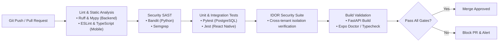

# StudyMate AI — Comprehensive Quality Assurance & Testing Plan

## 1. Testing Philosophy & Pyramid

StudyMate AI follows a strict **"Verify Before You Claim"** rule. No feature or endpoint is declared complete without accompanying automated test coverage that executes reliably in CI/CD pipelines.

```
                  ┌──────────────────────┐
                  │   End-to-End (E2E)   │
                  │   (Maestro / Detox)  │  ~10%
                  ├──────────────────────┤
                  │  Integration Tests   │
                  │ (Pytest Async, RNTL) │  ~30%
                  ├──────────────────────┤
                  │      Unit Tests      │
                  │ (Pytest, Jest, Mocks)│  ~60%
                  └──────────────────────┘
```

* **Coverage Mandate**: Minimum **80% line and branch coverage** across all backend domain services, repositories, and mobile utility libraries.
* **Hermetic & Isolated**: Tests do not rely on live third-party services. AI responses are mocked using deterministic fixtures in unit and integration tests.
* **No Complex Infrastructure Required for Tests**: Test suites execute with only an isolated PostgreSQL instance; no Redis or external brokers required.

---

## 2. Backend Testing Strategy (Python & FastAPI)

### 2.1 Test Framework & Setup
* **Test Runner**: `pytest` with `pytest-asyncio` for non-blocking asynchronous execution.
* **HTTP Client**: `httpx.AsyncClient` paired with `ASGITransport` for in-memory FastAPI testing.
* **Test Database**: Dedicated isolated PostgreSQL test database executing Alembic migrations before test runs.
* **Transaction Rollback Fixture**: Each test runs inside an isolated database transaction that rolls back upon completion, guaranteeing zero state leakage.
* **Storage Fixtures**: File operations use `tmp_path` fixtures for `LocalStorageBackend`.

### 2.2 Backend Test Categories

#### 1. Unit Tests (`tests/unit/`)
* Password hashing and verification routines (`core/security.py`).
* SuperMemo SM-2 spaced repetition calculation accuracy (`services/srs_service.py`).
* In-memory rate limiting logic (`core/rate_limit.py`).
* Pydantic schema validation for edge-case payloads (`schemas/`).

#### 2. Integration Tests (`tests/integration/`)
* **Authentication Flows**: Registration (confirming `role = 'student'`), login, token rotation, expired token rejection, logout.
* **Academic Hierarchy CRUD**: Creating semesters, adding subjects, archiving, ensuring cascading deletions function properly.
* **Note & Task Management**: Creating notes, markdown persistence, task subtask updates.
* **Document Ingestion**: Multipart upload, magic byte validation, and async text extraction handling.

#### 3. Security & IDOR Regression Suite (`tests/security/test_idor.py`)
A specialized automated test suite explicitly verifying application-level tenant isolation:
```python
@pytest.mark.asyncio
async def test_cross_user_note_access_forbidden(client: AsyncClient, user_a_token: str, user_b_note_id: str):
    """Assert that User A cannot read or modify User B's private notes."""
    headers = {"Authorization": f"Bearer {user_a_token}"}
    response = await client.get(f"/api/v1/notes/{user_b_note_id}", headers=headers)
    assert response.status_code == 404  # Must return 404 to avoid ID enumeration
```

#### 4. AI Provider Mocking & Schema Conformance (`tests/ai/`)
* Real AI API calls are intercepted using mock adapters (`MockAIProvider`).
* **Schema Conformance Tests**: Tests feed raw mock LLM outputs into Pydantic validators to assert that generated quizzes, flashcards, and Cornell notes adhere 100% to required JSON schemas.
* **Prompt Injection Resilience**: Evaluates how sanitizers escape malicious inputs.

---

## 3. Mobile Testing Strategy (React Native & Expo)

### 3.1 Test Framework & Tools
* **Unit & Component Testing**: `jest` with `@testing-library/react-native` (RNTL).
* **Mocking Layer**: Native modules (MMKV, Expo SecureStore, Expo Notifications) mocked via dedicated Jest setup files.
* **API Mocking**: Mock Service Worker (MSW) or Jest spy on the API client.
* **End-to-End Testing**: **Maestro** for high-speed, declarative mobile UI flows on Android emulators.

### 3.2 Mobile Test Suites

#### 1. Component & Hook Unit Tests (`apps/mobile/__tests__/`)
* **UI Design System Components**: Button states (active, loading, disabled), Form inputs with error labels.
* **Custom Hooks**:
  * `usePomodoro`: Verifies countdown math, tick intervals, pause/resume, and mode transitions (focus $\rightarrow$ short break).
  * `useTheme`: Verifies theme switching and MMKV persistence.
  * `useAuth`: Verifies token storage in Expo SecureStore and auto-logout on 401.

#### 2. Screen Integration Tests (RNTL)
* **Login Screen**: Renders inputs, validates email format, handles network errors, triggers navigation on success.
* **Pomodoro Screen**: Interacting with Start/Pause/Reset buttons updates timer visual elements.
* **Flashcard Review Screen**: Tapping card triggers 3D flip animation; tapping "Easy" triggers next card fetch.

#### 3. Maestro End-to-End (E2E) Mobile Flows (`apps/mobile/e2e/`)
Declarative Maestro YAML scripts executed against Android APK builds:
```yaml
appId: com.studymate.ai
---
- launchApp:
    clearState: true
- assertVisible: "Welcome to StudyMate AI"
- tapOn: "Log In"
- inputText:
    id: "email_input"
    text: "test.student@university.edu"
- inputText:
    id: "password_input"
    text: "Password123!"
- tapOn: "Sign In"
- assertVisible: "Today's Schedule"
- tapOn: "Pomodoro"
- assertVisible: "25:00"
- tapOn: "Start Focus"
- assertVisible: "Pause"
```

---

## 4. Performance & Load Testing

* **API Load Testing**: Using **k6** or **Locust** to simulate concurrent students hitting the dashboard summary endpoint.
  * SLA: 95th percentile latency $\le 200$ms under normal load.
* **Mobile Profiling**:
  * Cold launch time measured via Android Systrace / React Native Performance Monitor ($< 1.2$s target).
  * Memory leak monitoring during extended Pomodoro sessions.
  * Frame rate audit: Ensure screen scrolling and card flipping maintain 60 fps without dropped frames.

---

## 5. CI/CD Automated Test Pipeline Gates



* Pull requests cannot be merged if:
  1. Any unit or integration test fails.
  2. Test coverage drops below 80%.
  3. Static typing checks (`mypy --strict`, `tsc --noEmit`) encounter errors.
  4. IDOR security checks fail.
